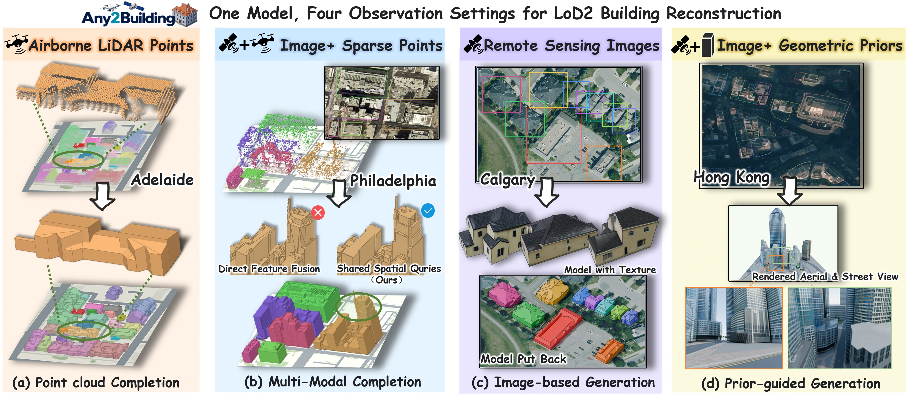

<div align="center">

# Any2Building

### Unifying Point Clouds and Images for Building Reconstruction via Shared Spatial Queries

**One model. Multiple observations. Structured buildings.**

[Project Page](https://henryhoou.github.io/Any2Building/) · [Hugging Face](https://huggingface.co/hongye02/Any2Building) · [Installation](#installation) · [Training](#training) · [Commercial Use](COMMERCIAL_USE.md)

</div>

<a href="https://huggingface.co/hongye02/Any2Building"></a>

Any2Building reconstructs compact **Level of Detail 2 (LoD2)** buildings from partial point clouds, overhead images, or both, with optional coarse geometric priors. Occupancy-supervised shared spatial queries align these observations in 3D before guiding a shared generator.

This repository provides the **Any2Building training and inference implementation**, requirements, and six small input examples. Pretrained models are available on [Hugging Face](https://huggingface.co/hongye02/Any2Building).

## News

-  **2026.11.01** — Our team won **National Champion · Grand Prize** in the **LoD2 Building Reconstruction Track** at the National LiDAR Point Cloud Conference. **全国激光雷达点云大会 LoD2 Building 重建赛道全国冠军、特等奖。**
-  **2026.06** — Our team won **Runner-up (2nd Place)** at the **BuildingWorld Workshop**. **BuildingWorld Workshop 亚军。**

## Overview

| Input | Task | CLI mode |
| --- | --- | --- |
| Partial point cloud | Point-cloud completion | `point` |
| Overhead image | Single-image generation | `image` |
| Points + image | Multimodal completion | `both` |
| Image + coarse geometry | Prior-assisted generation | `image_prior` |

The **Shared Spatial Query Conditioner** operates on a 16³ grid. Occupancy-supervised queries enrich condition tokens and provide spatial prompts to **SpatialPromptDiT**. A separate voxel-conditional surface generator and optional external RoLoPM remeshing turn predicted structure into compact LoD2 geometry. See [paper-to-code mapping](docs/PAPER_MAPPING.md).

The package and environment are named `any2building`. Reused TRELLIS/TRELLIS.2 primitives live under `any2building/backbone`; an installed `trellis2` repository is not required. Upstream attribution and licenses are preserved in [THIRD_PARTY.md](THIRD_PARTY.md).

## Installation

Use Linux, Python 3.10, a CUDA-capable NVIDIA GPU, and the CUDA 12.4 PyTorch stack. A CUDA development toolkit is needed when building FlashAttention or the optional surface extensions. Create a dedicated environment:

```bash
git clone https://github.com/HenryHoou/Any2Building.git
cd Any2Building
conda create -n any2building python=3.10 -y
conda activate any2building
python -m pip install -r requirements-torch.txt
python -m pip install -r requirements.txt
python -m pip install --no-build-isolation -r requirements-cuda.txt
```

Run commands from this directory. No editable installation or external repository checkout is needed. The structure stage supports `ATTN_BACKEND=sdpa` as an alternative to FlashAttention; released comparisons use FlashAttention with BF16. This environment uses Transformers **4.57.1** for DINOv3 and is separate from older TRELLIS/MeshAnything environments pinned to Transformers 4.46.3. Existing environments need no changes.

## Model weights

Download [Any2Building_weights.zip](https://huggingface.co/hongye02/Any2Building/resolve/main/Any2Building_weights.zip) from Hugging Face and extract it into this code-release root.
The weight paths follow the paper modules; see [the weight layout](weights/README.md).
The archive contains the selected EMA structure weights, the separate surface
generator and the required decoders. For image-conditioned tasks, obtain the
frozen DINOv3 model from its official distribution and place it in `weights/image_tokenizer`.
Run `python tools/validate_release.py --weights --hashes` to check the released
weight files after extraction. This does not validate the separately obtained DINOv3 model.

The included point clouds and images are ready to use with the example commands below.

## Inference

```bash
python infer.py --examples --outdir outputs/paper_examples
```

The six input cases are the three point-cloud rows of panel A and the three single-image rows of panel B in the supplied main qualitative figure. Inputs are in `examples/point_01` through `point_03` and `examples/image_01` through `image_03`. `examples/manifest.json` maps them to the figure. The point clouds contain the actual 16,384 inference points, not the small sphere meshes used for rendering. PNG metadata has been removed while retaining image pixels.

Select one example:

```bash
python infer.py --examples --case point_01 --outdir outputs/one_point
python infer.py --examples --case image_01 --outdir outputs/one_image
```

Only the three input point NPZ files and three input PNG images are bundled. Inference creates occupancy, latent, query-logit and mesh-preview outputs under the requested `--outdir`; no prediction or reference-output files are included.

## Custom observations

```bash
python infer.py --mode point --points input_points.npz --outdir outputs/point
python infer.py --mode image --image overhead.png --outdir outputs/image
python infer.py --mode both --points input_points.npz --image overhead.png --outdir outputs/both
python infer.py --mode image_prior --image overhead.png --prior prior_surface.npz --outdir outputs/prior
```

Point inputs must already use the common normalized XYZ building frame `[-0.5,0.5]`; images and priors must align with it. A prior uses the `occupancy` or `coords` NPZ key. See [docs/DATA.md](docs/DATA.md) for normalization, axis ordering, alpha handling, training data, and prior descriptors. Existing result directories are protected from overwriting.

## Surface generation and LoD2 remeshing

The Any2Building model predicts a 64³ **surface-occupancy grid**. `structure_preview.ply` is a voxel visualization. To run the paper's learned surface stage, install the optional compiled dependencies:

```bash
python -m pip install --no-build-isolation -r requirements-surface.txt
python surface.py --occupancy outputs/one_point/point_01/occupancy.npz --output outputs/one_point/point_01/surface.ply
```

The voxel-conditional surface generator uses the released surface EMA weights and frozen 1024-resolution decoder from the Hugging Face model archive. This is a fixed surface-stage checkpoint, separate from the Any2Building structure weights. It consumes predicted occupied coordinates directly, with no interior filling and no point/image conditioning.

Compact LoD2 output uses the external RoLoPM CLI. After obtaining its official executable, use the adapter below (omit `--runner wine` on Windows):

```bash
python remesh.py --mesh outputs/one_point/point_01/surface.ply --outdir outputs/one_point/point_01/lod2 --executable /path/to/SurfaceRemeshingCli_bin.exe --runner wine --screen-size 100
```

RoLoPM is not bundled. Texturing and figure layout are downstream operations outside this Any2Building code artifact.

## Training

The original Any2Building optimizer/DDP/EMA engine and the exact query-occupancy plus decoded-geometry losses are retained. There are two data paths: a portable JSONL loader for prepared observations, and the historical quality-controlled loader with image preparation, source/city weighting, sparse-point sampling, and point degradation. The latter has path-neutral reference configurations in `configs/reference_*.json`; full training data are not included.

```bash
# One-step smoke run on a separately prepared training manifest.
python train.py --manifest data/train.jsonl --output outputs/train_smoke --additional-steps 1 --batch-size 1 --batch-split 1

# Fine-tune on a real prepared training split; global batch = GPUs * batch-size.
torchrun --standalone --nproc_per_node=2 train.py --manifest data/train.jsonl --output outputs/finetune --batch-size 32 --batch-split 8 --additional-steps 2000
```

Training observations and target latents must be supplied separately; demonstration inputs must not be used as benchmark training data. Default fine-tuning starts from the released EMA weights with a **new optimizer and sampler**, counting new updates from zero. `--resume STEP` restores complete checkpoints produced by this release's training entry. Historical Any2Building optimizer states and the full training corpus are not included. `--init scratch` starts a new experiment; it does not reproduce the full historical training curriculum. See [docs/TRAINING.md](docs/TRAINING.md) and [docs/PAPER_MAPPING.md](docs/PAPER_MAPPING.md).

The separate surface trainer uses a separately prepared sparse-latent manifest:

```bash
python train_surface.py --manifest data/surface_train.jsonl --output outputs/surface_smoke --additional-steps 1
```

## Verification and contents

```bash
python tools/validate_release.py
python tools/validate_release.py --hashes
```

`weights/manifest.json` records the checkpoint roles, tensor counts and SHA-256 checksums. `SHA256SUMS` covers the files distributed in this code/examples release, excluding Git metadata. `validation/release_validation.json` records this release's scope and points to the earlier runtime verification.

The runtime results in `validation/runtime_validation.json` record earlier GPU checks of structure inference, training, checkpoint resume and surface generation in a compatible CUDA environment. They describe the tested release configuration, not a new run of the current entry points. A fresh dependency installation and multi-GPU training were not exercised.

## Commercial use

Original Any2Building contributions follow the **AI4City Technology License v1.0**, consistent with the lab's [BuildAnyPoint licensing policy](https://github.com/ai4city-hkust/BuildAnyPoint/blob/main/LICENSE). Use is limited to non-commercial academic research and internal evaluation. Commercial deployment, product integration, paid services and other commercial use require prior written authorization.

**Commercial licensing, collaboration and technology transfer:** [wufanzhao@hkust-gz.edu.cn](mailto:wufanzhao@hkust-gz.edu.cn).

商业使用须取得 AI4City 实验室书面授权。详见 [商业说明 / Commercial Use](COMMERCIAL_USE.md) 和 [LICENSE](LICENSE)。Third-party code, data and weights retain their own licenses; these terms do not override them.

## Citation

```bibtex
@misc{any2building2026,
  title = {Any2Building: Unifying Point Clouds and Images for Building Reconstruction via Shared Spatial Queries},
  author = {Hongye Hou and others},
  year = {2026},
  note = {Manuscript},
  url = {https://henryhoou.github.io/Any2Building/}
}
```

## Acknowledgements

We acknowledge TRELLIS/TRELLIS.2, DINOv3, the AdaPoinTr/EdgeConv lineage, FlexGEMM, CuMesh, O-Voxel, utils3d and RoLoPM. The repository and project-page organization take inspiration from our group's [BuildAnyPoint](https://github.com/ai4city-hkust/BuildAnyPoint/). Full dependency attribution is retained in [THIRD_PARTY.md](THIRD_PARTY.md).
